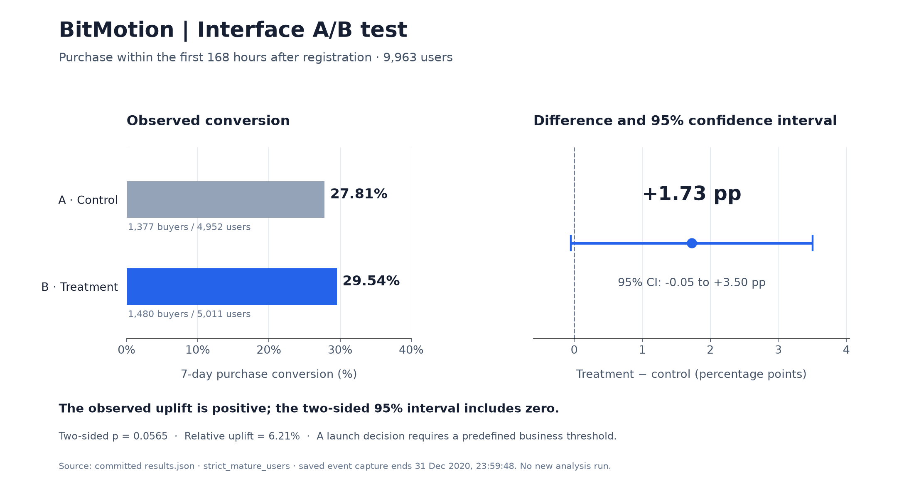

# BitMotion Interface A/B Test


An analysis of an online store experiment testing whether a redesigned interface increases the share of users who make a purchase within seven days of registration.

**Python · pandas · NumPy · A/B testing**

[Notebook](analysis.ipynb) · [Analysis script](analysis.py) · [Results](results.json)

## Objective

Check experiment assignments, compare purchase conversion between groups, and assess the evidence for launching the redesigned interface.

## Work completed

- Checked group assignments and participation in a parallel experiment.
- Built a cohort of **9,963 users** with a complete observation window.
- Calculated conversion at the user level over the first **168 hours**.
- Estimated absolute and relative uplift, a confidence interval, and statistical significance.
- Compared the results under two definitions of the seven-day window.

## Results



The figure visualizes the committed `results.json` (`strict_mature_users`): the first 168 hours after registration, with a complete observation window for all 9,963 users. It is a rendering of saved results, not a new analysis run.

Control group conversion: **27.81%**. Treatment group conversion: **29.54%**.

The observed uplift is **1.73 percentage points**, or **6.21% relative to the control group**. The approximate two-sided 95% confidence interval for the difference is **−0.05 to +3.50 percentage points**.

The one-sided p-value for an improvement is **0.0283**; the two-sided p-value is **0.0565**. The direction of the test must be specified before examining the results.

**Conclusion:** the observed effect is positive. A launch decision requires a predefined test design and a business threshold for a worthwhile improvement; the results alone do not establish that the business target was reached.

## Files

- `analysis.ipynb` — notebook version of the calculation.
- `analysis.py` — reproducible analysis.
- `results.json` — saved calculation results.
- `download_data.py` — downloads the public source files.
- `requirements.txt` — dependencies.

## Run locally

Requires Python 3.12 or later. From the project directory:

```bash
python -m pip install -r requirements.txt
python download_data.py
python analysis.py
```

Source data is downloaded separately and is not included in the repository. The notebook has no saved execution outputs; the checked results are available in `results.json`.
