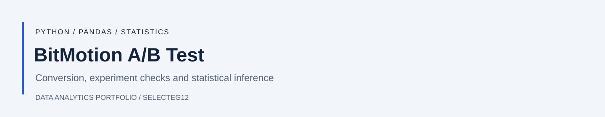
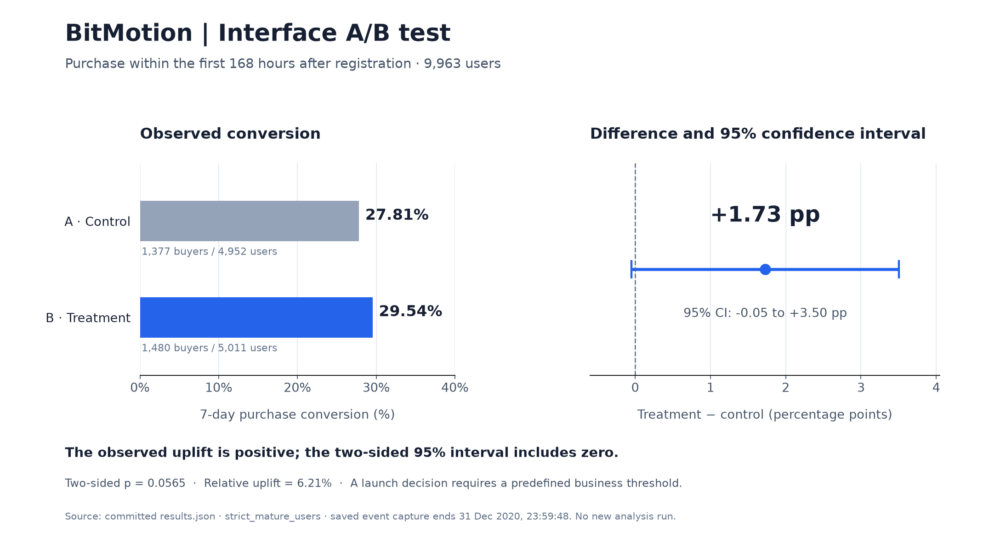

**English** | [Русский](README.ru.md)

# BitMotion Interface A/B Test



Does a redesigned store interface increase purchases within seven days of registration? This project checks the experiment, compares user-level conversion and estimates the size of the effect.

**Python · pandas · NumPy · A/B testing**

[Notebook](analysis.ipynb) · [Analysis script](analysis.py) · [Results](results.json)

## Analysis

- Checked group assignments and participation in a parallel experiment.
- Selected **9,963 users** with a complete observation window.
- Measured purchases during the first **168 hours** after registration.
- Calculated absolute and relative uplift, confidence intervals and p-values.
- Compared two definitions of the seven-day window.

## Results



The chart uses the saved `strict_mature_users` results in `results.json`.

| Measure | Result |
| --- | --- |
| Control conversion | **27.81%** |
| Treatment conversion | **29.54%** |
| Absolute uplift | **1.73 percentage points** |
| Relative uplift | **6.21%** |
| Approximate two-sided 95% confidence interval | **−0.05 to +3.50 percentage points** |
| One-sided p-value for improvement | **0.0283** |
| Two-sided p-value | **0.0565** |

The observed effect is positive, but the two-sided confidence interval includes zero. The test direction should be chosen before looking at the results. A launch decision also needs a predefined business threshold for a worthwhile improvement.

## Run locally

Requires Python 3.12 or later:

```bash
python -m pip install -r requirements.txt
python download_data.py
python analysis.py
```

`download_data.py` fetches the source data separately. `analysis.py` reproduces the calculations; `analysis.ipynb` contains the notebook version. The notebook has no saved execution outputs, so use `results.json` to inspect the saved results.
