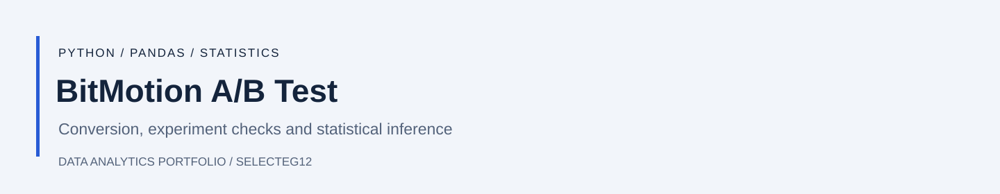
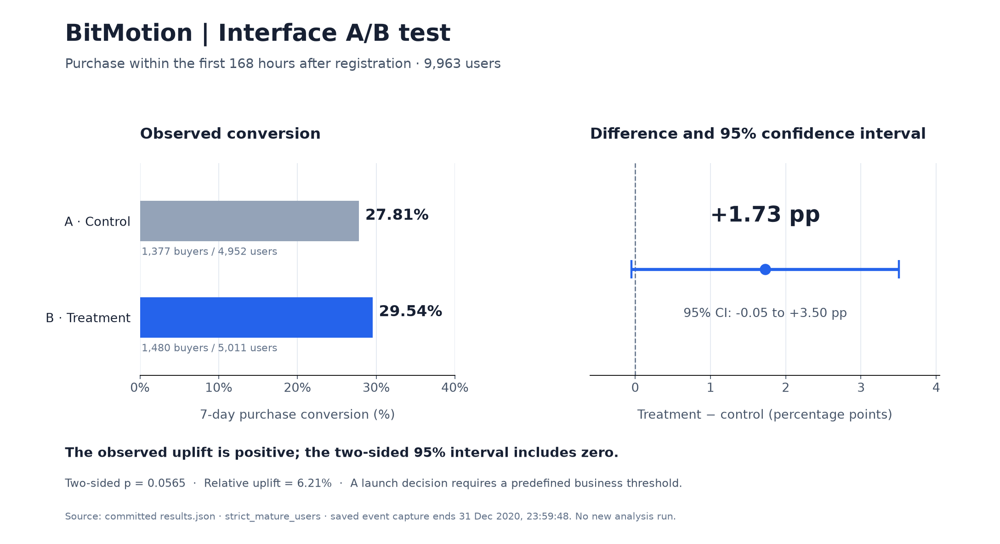

[English](README.md) | **Русский**

# A/B-тест интерфейса BitMotion



Повышает ли новый интерфейс магазина конверсию в покупку в течение семи дней после регистрации? В проекте проверяется корректность эксперимента, сравнивается конверсия пользователей и оценивается размер эффекта.

**Python · pandas · NumPy · A/B-тестирование**

[Блокнот](analysis.ipynb) · [Скрипт анализа](analysis.py) · [Результаты](results.json)

## Анализ

- Проверены распределение по группам и участие в параллельном эксперименте.
- Отобраны **9 963 пользователя** с полным периодом наблюдения.
- Покупки учитываются в первые **168 часов** после регистрации.
- Рассчитаны абсолютный и относительный прирост, доверительные интервалы и p-value.
- Сопоставлены два определения семидневного окна.

## Результаты



График построен по сохранённым результатам `strict_mature_users` из `results.json`.

| Показатель | Результат |
| --- | --- |
| Конверсия контрольной группы | **27.81%** |
| Конверсия тестовой группы | **29.54%** |
| Абсолютный прирост | **1.73 процентного пункта** |
| Относительный прирост | **6.21%** |
| Приблизительный двусторонний 95%-й доверительный интервал | **−0.05…+3.50 процентного пункта** |
| Односторонний p-value для улучшения | **0.0283** |
| Двусторонний p-value | **0.0565** |

Наблюдаемый эффект положительный, но двусторонний доверительный интервал включает ноль. Направление теста нужно выбирать до просмотра результатов. Для решения о запуске также нужен заранее определённый бизнес-порог полезного улучшения.

## Локальный запуск

Нужен Python 3.12 или новее:

```bash
python -m pip install -r requirements.txt
python download_data.py
python analysis.py
```

`download_data.py` отдельно скачивает исходные данные. `analysis.py` воспроизводит расчёты, а `analysis.ipynb` содержит версию анализа в блокноте. Сохранённых выводов ячеек в блокноте нет; рассчитанные результаты доступны в `results.json`.
